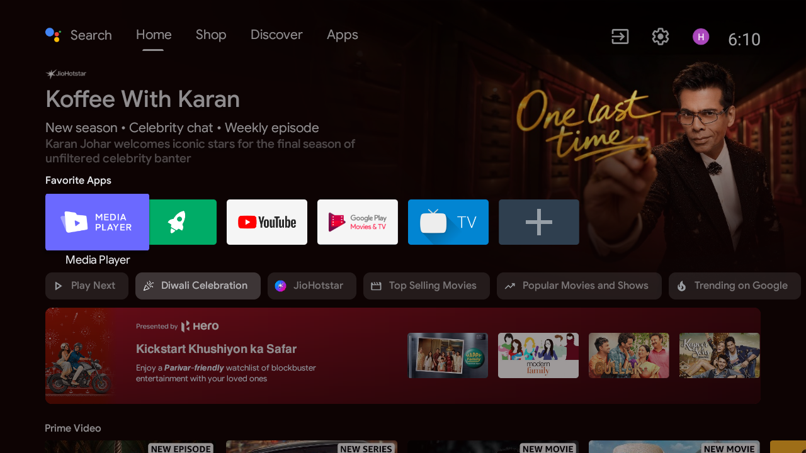
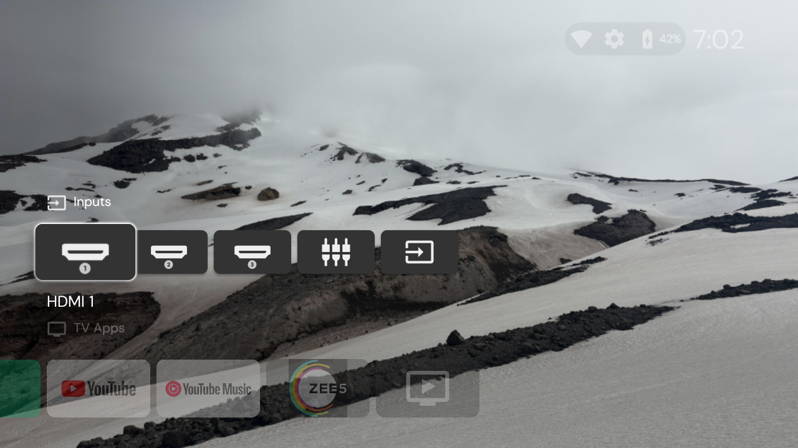
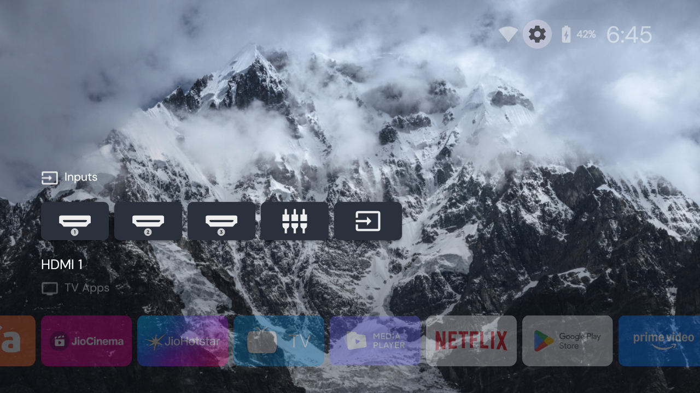

# Mi TV AXSO0 — Debloat & Optimization

Scripts, notes and helper apps from cleaning up a Xiaomi **MiTV-AXSO0**
(Mi TV 4A 43", codename `dangal`) running Android 9 with 1 GB RAM.

The goal was simple: fewer preinstalled apps, less background telemetry, more
free storage/RAM, and an ad-free home screen — without losing Netflix, YouTube
or the streaming apps actually in use.




## Results

| Metric | Before | After |
|---|---|---|
| Free storage on `/data` | 753 MB (84% used) | **~2.0 GB (54%)** |
| Free RAM | 60 MB | **~140 MB** |
| Available RAM | 190 MB | **~390 MB** |
| Third-party apps | 21 | **7 kept + Projectivy + Zee5 tile** |
| Disabled system packages | 0 | **31** |
| Home screen | Xiaomi/PatchWall ads | **Projectivy, Inputs + TV Apps** |

- 16 unused preinstalls removed (Voot, MX Player, YouTube Kids, Play Movies/Music/Games, Hoichoi, ShemarooMe, Eros, ALT Balaji, EPIC ON, Discovery+, Hungama, Mi TV+, Sensara, …).
- Kept: Prime Video, JioHotstar, Zee5, SonyLIV, JioCinema, aha, SunNXT, Netflix, YouTube.
- Xiaomi telemetry/analytics, PatchWall, Mi Link/Miracast, OTA checks and
  recommendation services disabled.
- Streaming apps restricted from background execution (`RUN_ANY_IN_BACKGROUND ignore`).
- Screen timeout raised from 5 to 30 minutes.

## Repo layout

```
apply.sh              # remove/disable packages + apply settings
backup.sh             # pull APKs and settings before changing anything
restore.sh            # revert packages, APKs and settings
REPORT.md             # detailed change log, caveats and per-app restore commands
zee5-shortcut/        # tiny helper app that gives Zee5 a launcher tile
docs/                 # before/after screenshots
```

`backups/`, `tools/`, APKs and keystores are git-ignored.

## Usage

Requirements: `adb` on the host, TV with developer options + wireless debugging.

```bash
adb connect <TV_IP>:5555
./backup.sh      # always do this first
./apply.sh
./restore.sh     # full revert (re-enables packages, reinstalls APKs, reboots)
```

The package lists are specific to this firmware (MiTV-AXSO0, Android 9,
`PI.6036`). Review `apply.sh` / `restore.sh` before running on another model.

## Launcher

The stock launcher is Xiaomi's PatchWall-flavoured build of `com.google.android.tvlauncher`,
including a Shop tab and "Hero" ads. It was replaced with
[Projectivy Launcher](https://github.com/spocky/miproja1) 4.72:

```bash
adb install -r ProjectivyLauncher-<version>.apk
adb shell pm set-home-activity com.spocky.projengmenu/.ui.home.MainActivity
adb shell pm disable-user --user 0 com.google.android.tvlauncher
```

Xiaomi keeps its home task sticky, so merely setting the default HOME activity is
not enough — the stock launcher must be disabled. Revert with:

```bash
adb shell pm enable --user 0 com.google.android.tvlauncher
adb shell pm set-home-activity com.google.android.tvlauncher/.MainActivity
```

Projectivy provides the HDMI input tiles, app grid and wallpaper:



The cluttered "Watch Next" row can be toggled under
**Settings → Edit channels → Watch Next**.

### Zee5 tile

Xiaomi's preinstalled Zee5 build (`com.zee5.xiaomiTV`) has **no launcher intent** —
it was designed to be opened from PatchWall tiles, so it disappears when PatchWall
is disabled. `zee5-shortcut/` contains a 232 KB helper app with a single
`LEANBACK_LAUNCHER` activity that starts Zee5's exported `SplashActivity`.

```bash
cd zee5-shortcut
ANDROID_SDK=/path/to/sdk ./build.sh
adb install -r zee5-shortcut.apk
```

Requires build-tools 34.0.0 and platforms/android-28. The APK is debug-signed;
the source is in `src/` and the icon is committed. `com.aha.mitv` and
`com.suntv.sunnxt.mitv` have the same missing-launcher limitation and can use
the same approach.

## Notes

- **Casting**: Miracast/MiPlay and Mi Link are disabled (aggressive tier). Re-enable
  `com.xiaomi.mitv.smartshare` / `com.mitv.milinkservice` if needed.
- **Firmware updates**: OTA checks are disabled. Re-enable
  `com.xiaomi.mitv.updateservice` to restore them.
- **Remote**: a weak Mi Remote battery can look like a dead TV (red LED clears,
  black screen). Replace the batteries or use the Mi Remote phone app.
- **After a factory reset**, the stock launcher and preinstalled apps return.
  Re-run `backup.sh` + `apply.sh` and reinstall Projectivy/the Zee5 tile.
- Everything here is user-space package/setting changes; no root required.
  Use at your own risk.
